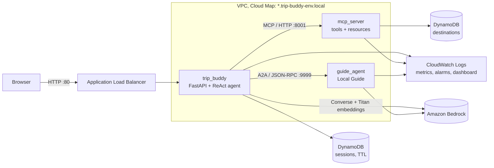

# Trip Buddy on AWS: a multi-agent trip planner

Trip Buddy plans group trips from Bengaluru: *"We are 4 friends with ₹12,000 each. Can we do Goa for 3 nights in December? What should we do there?"*

It is three cooperating services on **Amazon ECS Fargate**:

| Service | What it does | Protocol | Exposed |
|---|---|---|---|
| `trip_buddy` | FastAPI API + chat UI. RAG over a travel notebook, a ReAct agent loop, chat memory | HTTP (public) | ALB :80 |
| `mcp_server` | Prices, destinations and exact cost maths as **MCP** tools, resources and a prompt | MCP over streamable HTTP | private (Cloud Map) |
| `guide_agent` | A separate **A2A** agent that knows things to do, food and weather | A2A JSON-RPC | private (Cloud Map) |



## Evidence: it ran on AWS

The demo stack is torn down between sessions to save cost. This is what it looked like live on ECS Fargate in `us-east-1`:

| Live app: budget check + MCP tools + A2A guide | Monsoon warning from RAG |
|---|---|
|  |  |

The chips under each answer show the agent's trajectory: `mcp: db_lookup`, `mcp: compute_trip_cost`, `a2a: ask_local_guide`, the RAG tips retrieved, and the latency.

- [docs/evidence/evals-live.json](docs/evidence/evals-live.json): the 6 golden evals against the live URL, with every answer, tool call and latency
- [docs/evidence/aws-deployment.md](docs/evidence/aws-deployment.md): AWS CLI snapshot of the stack, the ECS services, Cloud Map DNS, DynamoDB, SSM, alarms, the custom latency metric and structured logs
- [docs/evidence/tests.txt](docs/evidence/tests.txt): the local test run
- [Hampi, odd-sized group](docs/evidence/03-hampi-odd-group.png) · [deep health check](docs/evidence/04-health-deep.png)

To reproduce, deploy and then run:

```bash
python evals/run_evals.py <url> --report docs/evidence/evals-live.json
```

```bash
python evals/capture_screenshots.py <url>
```

```bash
./scripts/collect_evidence.sh > docs/evidence/aws-deployment.md
```

## What is in here

```
services/
  trip_buddy/     app.py (API), agent.py (ReAct over MCP + A2A), rag.py, sessions.py, static/index.html
  mcp_server/     server.py (FastMCP, streamable HTTP), destinations.py (DynamoDB / in-memory)
  guide_agent/    agent.py (A2A agent card + executor)
shared/           LLM provider switch (Bedrock | OpenAI), JSON logging, trip maths
infra/
  trip-buddy-stack.yaml   VPC, ALB, ECS, Cloud Map, DynamoDB, IAM, alarms, dashboard
  github-oidc.yaml        one-time: GitHub OIDC deploy role + scoped CloudFormation execution role
scripts/          deploy.sh, destroy.sh (used by CI and by hand)
.github/workflows ci.yml (lint, tests, cfn-lint, image builds), deploy.yml, destroy.yml
tests/            unit + integration tests (real MCP/A2A servers, scripted LLM: no keys needed)
evals/            golden questions graded on answer AND tool trajectory, run after each deploy
```

## Engineering decisions

- **The model never does maths.** `compute_trip_cost` is an MCP tool with Pydantic bounds (1-20 people, 1-30 nights) enforced by the server. Evals check exact totals (₹11,800, ₹4,300, ₹14,933).
- **Trust boundary.** The agent only executes tools the MCP server advertised plus `ask_local_guide`. Anything else is logged as `blocked`. Tool output is treated as data, not instructions.
- **Graceful degradation.** If the guide agent is down, Trip Buddy still answers costs and says local tips are unavailable (tested).
- **Least privilege.** Each service has its own task role: MCP can only touch the destinations table, and the API only the sessions table and Bedrock. GitHub Actions uses OIDC (no stored keys) and can only push `trip-buddy-*` images and run CloudFormation through an execution role that can only manage `trip-buddy-*` IAM roles.
- **Safe deploys.** ECS deployment circuit breaker with automatic rollback, a `/health/deep` smoke test, then evals against the live URL.
- **Observability.** JSON logs → CloudWatch metric filters (`AgentLatencyMs`, `AgentErrors`), alarms on 5xx, unhealthy hosts and p90 agent latency, and a dashboard with a tool-usage breakdown.
- **Right-sized RAG.** 13 tips do not need a vector database: a NumPy cosine index built at startup. The `TravelNotebook` class is the seam for OpenSearch Serverless or S3 Vectors.
- **Cost.** No NAT gateway (public subnets with locked-down security groups), on-demand DynamoDB, 0.25-0.5 vCPU tasks, 14-day log retention, ECR keeps the last 10 images.

## Run locally

Needs Docker and an OpenAI key, or AWS credentials with Bedrock access.

```bash
cp .env.example .env
```

Edit `.env` to add your key, then start the stack:

```bash
docker compose up --build
```

Open http://localhost:8000. Check the wiring at http://localhost:8000/health/deep.

Tests (no keys, no AWS):

```bash
python -m venv .venv && .venv/Scripts/pip install -r requirements-dev.txt
```

```bash
.venv/Scripts/python -m pytest -q
```

Evals against a running stack:

```bash
.venv/Scripts/python evals/run_evals.py http://localhost:8000
```

## Deploy to AWS

**Region:** us-east-1. Two ways to reach the model, picked with `LLM_PROVIDER`:

- `bedrock` (stack default): Bedrock Converse API through each task's IAM role, with no key. The model is `BedrockModelId` (Nova Lite).
- `openai`: any OpenAI-compatible endpoint. The live demo uses **Bedrock's OpenAI-compatible Mantle endpoint** with `openai.gpt-oss-120b`, because Converse is blocked on this Free-plan account. The key lives only in SSM Parameter Store:
  ```bash
  aws ssm put-parameter --name /trip-buddy/openai-api-key --type SecureString --value file://key.txt
  ```
  Then deploy with:
  ```bash
  LLM_PROVIDER=openai EMBEDDINGS_PROVIDER=local OPENAI_BASE_URL=https://bedrock-mantle.us-east-1.api.aws/v1 OPENAI_PROJECT_ID=<project> ENV_NAME=dev ./scripts/deploy.sh
  ```
  `EMBEDDINGS_PROVIDER=local` uses a built-in hashing embedder, because Mantle serves chat models only.

### Option A: by hand from Git Bash

1. Sign in to AWS: `aws login` (or `aws configure`), then confirm with `aws sts get-caller-identity`.
2. Deploy. This creates the ECR repos, builds and pushes 3 images, deploys the stack and smoke-tests it:
   ```bash
   ENV_NAME=dev ./scripts/deploy.sh
   ```
3. Open the printed `App URL`. Run the evals against it:
   ```bash
   .venv/Scripts/python evals/run_evals.py http://<App URL>
   ```
4. **Tear down when finished**, so you are not billed:
   ```bash
   ENV_NAME=dev DELETE_IMAGES=1 ./scripts/destroy.sh
   ```

### Option B: GitHub Actions (OIDC, no stored keys)

1. Push this folder to a new GitHub repository.
2. One-time bootstrap (use `CreateOidcProvider=false` if your account already has the GitHub provider, for example from the inventory-agent project):
   ```bash
   aws cloudformation deploy --stack-name trip-buddy-github-oidc --template-file infra/github-oidc.yaml --capabilities CAPABILITY_NAMED_IAM --parameter-overrides GitHubRepo=<owner>/<repo> CreateOidcProvider=true
   ```
3. Copy the two stack outputs into the repository's **Settings → Secrets and variables → Actions → Variables** as `AWS_ROLE_ARN` and `CFN_EXECUTION_ROLE_ARN`. You can also add `ALARM_EMAIL`.
4. Under **Actions → Deploy to AWS → Run workflow**, choose `dev`. The run builds, deploys, smoke-tests, runs evals and prints the URL in the run summary.
5. Use **Destroy AWS environment** to delete the stack when you are done.

### Cost

With one task per service running continuously, the cost is about **$1-1.5/day**: the ALB is about $0.55/day and three small Fargate tasks are about $0.6/day. Bedrock Nova Lite and DynamoDB cost cents for demo traffic. Deploy, record a demo, then destroy. You can also set `DESIRED_COUNT=0` to stop compute but keep the stack.

## Resume bullets

- Built a **multi-agent travel planner** in which a ReAct agent uses an **MCP** tool server and delegates to a second agent over **A2A**. It grounds answers with RAG and keeps per-session memory in **DynamoDB** with TTL.
- Deployed it as **3 microservices on AWS ECS Fargate** behind an ALB, with **Cloud Map** service discovery, **Amazon Bedrock** (gpt-oss-120b via the OpenAI-compatible endpoint, with a provider switch to the Converse API), secrets in **SSM Parameter Store**, least-privilege IAM per service, and infrastructure as code in **CloudFormation**. It passes 6/6 golden evals live with a p50 latency of about 3.6s.
- Shipped a **GitHub Actions CI/CD** pipeline using **OIDC** (no long-lived keys). It runs lint, unit and integration tests and cfn-lint, then builds images to ECR, deploys with circuit-breaker rollback, smoke-tests, and runs **post-deploy LLM evals** that grade both answers and tool trajectories.
- Added **observability**: structured JSON logs, CloudWatch metric filters for agent latency and errors, alarms (5xx, unhealthy hosts, p90 latency) to SNS, and a dashboard with a tool-usage breakdown.
